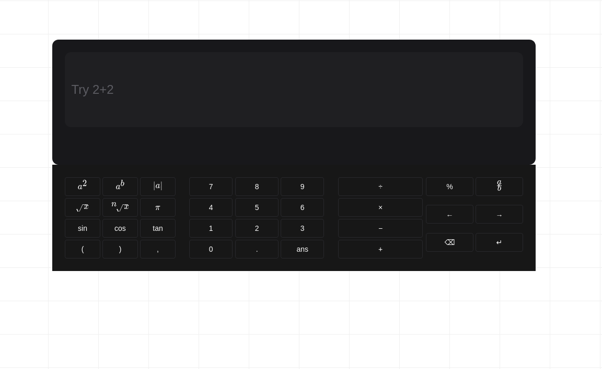

<!-- Improved compatibility of back to top link: See: https://github.com/othneildrew/Best-README-Template/pull/73 -->


<!-- PROJECT LOGO -->
<div align="center">
  <a href="https://maa-s-alpha.vercel.app/">
    
  </a>

  <h2><strong>Math As A Service (MaaS)</strong></h2>

  <p>
    <a href="https://github.com/Xhand98/MaaS"><strong>Explore the code!</strong></a>
    ·
    <a href="https://maa-s-alpha.vercel.app">View Demo</a>
    ·
    <a href="https://github.com/Xhand98/MaaS/issues/new?labels=bug">Report Bug</a>
    ·
    <a href="https://github.com/Xhand98/MaaS/issues/new?labels=enhancement">Request Feature</a>
  </p>
</div>

<!-- ABOUT THE PROJECT -->
## About The Project
[](https://maa-s-alpha.vercel.app)

There are a lot of math solving websites (calcs [short for calculator btw]) but what diferences MaaS from those other guys? We want _maneeyyyy_
Here's our amazing & expensive features:
* Arithmetic level math
* Basic algebra level math
* Fair pricing for both our end and customers end.


### Built With

* [![Next][Next.js]][Next-url]


<!-- GETTING STARTED -->
## Getting Started

This is how to get the project running on your end.

### Prerequisites

* npm
  ```sh
  npm install npm@latest -g
  ```

### Installation


1. Get a free API Key at [Wolfram Developer Access](https://developer.wolframalpha.com/access)
2. Clone the repo
   ```sh
   git clone https://github.com/Xhand98/MaaS.git
   ```
3. Install NPM packages
   ```sh
   npm install
   ```
4. Enter your API in `.env`
   ```js
   APPID = 'YOUR-APPID';
   ```
5. Then start the web with
   ```sh
   npm run dev
    ```
6. Open the website at
  ``` sh
  http://localhost:3000
  ```
<p align="right">(<a href="#readme-top">back to top</a>)</p>


<!-- TODO -->
<!--## Roadmap

- [ ]
- [ ] 
- [ ] 
- [ ] 
- [ ] 

See the [open issues](https://github.com/othneildrew/Best-README-Template/issues) for a full list of proposed features (and known issues).

<p align="right">(<a href="#readme-top">back to top</a>)</p>


<!-- LICENSE -->
## License

Distributed under the Unlicense License. See `LICENSE` for more information.

<p align="right">(<a href="#readme-top">back to top</a>)</p>


<!-- CONTACT -->
## Contact

[@Xhand98](https://x.com/xhand98) - hendrickherrera9@gmail.com

[https://github.com/Xhand98/MaaS](https://github.com/Xhand98/MaaS)

<p align="right">(<a href="#readme-top">back to top</a>)</p>


<!-- MARKDOWN LINKS & IMAGES -->
[Next.js]: https://img.shields.io/badge/next.js-000000?style=for-the-badge&logo=nextdotjs&logoColor=white
[Next-url]: https://nextjs.org/
